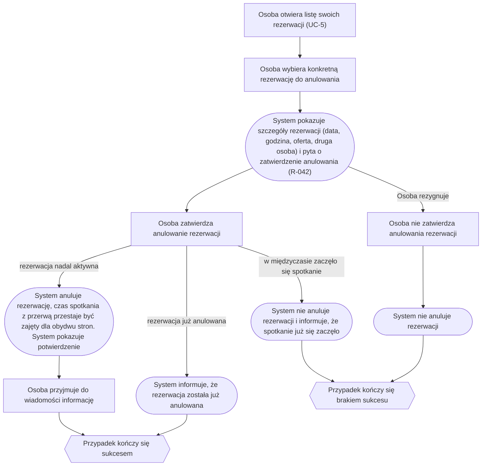
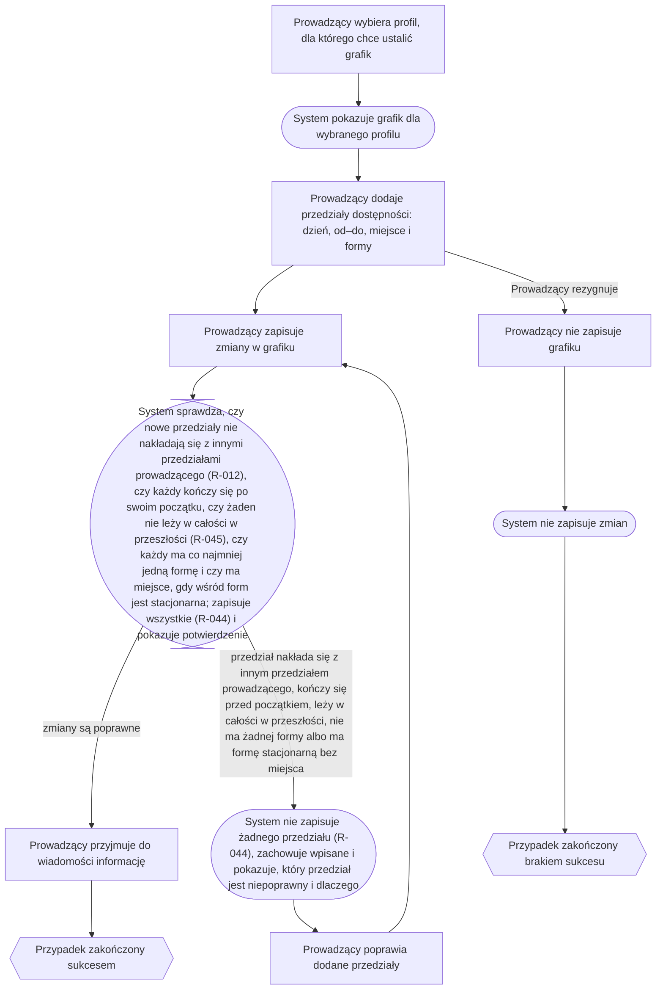

# Nestumi — przypadki użycia v1

Przypadek użycia opisuje, jak aktor osiąga cel i co się dzieje, gdy coś idzie inaczej (wg Alistaira Cockburna). Pojęcia jak w `docs/glossary.md`, decyzje w `docs/decisions.md`.

## Lista celów

| #   | Aktor                          | Cel                                       |
| --- | ------------------------------ | ----------------------------------------- |
| 1   | Anonimowy odwiedzający / osoba | znaleźć ofertę w katalogu                 |
| 2   | Anonimowy odwiedzający         | zarejestrować się                         |
| 3   | Osoba                          | zarezerwować wolny termin                 |
| 4   | Uczestnik / prowadzący         | anulować rezerwację                       |
| 5   | Osoba                          | przejrzeć swoje rezerwacje                |
| 6   | Osoba                          | założyć profil zawodowy                   |
| 7   | Prowadzący                     | utworzyć szkic oferty                     |
| 8   | Prowadzący                     | opublikować ofertę                        |
| 9   | Prowadzący                     | edytować ofertę                           |
| 10  | Prowadzący                     | wycofać ofertę                            |
| 11  | Prowadzący                     | ustawić grafik z przedziałami dostępności |
| 12  | Prowadzący                     | zmienić lub usunąć przedział dostępności  |
| 13  | Prowadzący                     | skopiować grafik na wybrane tygodnie      |

Nie są osobnymi celami: logowanie (krok wewnątrz innych celów), zmiana miejsca spotkania (R-009: anulowanie + zmiana grafiku).

Poza v1: zapoznać się z powiadomieniami (R-038), dodać lub zmienić link do spotkania online (R-039).

## Pełne opisy

### UC-3: zarezerwować wolny termin

Aktor: Osoba

Cel: Zarezerwować wolny termin

Warunki wstępne: Oferta musi być opublikowana

Wynik: Osoba rezerwuje wolny termin; Prowadzącemu ten termin staje się zajęty; Prowadzący i Osoba widzą szczegóły rezerwacji; Inne osoby nie mogą zarezerwować tego terminu; Rezerwacja jest potwierdzona; Po rezerwacji Osoba staje się uczestnikiem; Znikają wszystkie wolne terminy Prowadzącego (także innych jego ofert), które nakładają się na czas spotkania razem z przerwą po nim

1. Osoba wybiera konkretną ofertę u konkretnego Prowadzącego.
2. Osoba wybiera wolny termin, który jej pasuje, oraz formę spotkania.
3. System pokazuje podsumowanie rezerwacji i pyta o chęć dokonania rezerwacji
4. Osoba składa rezerwację
5. System sprawdza, czy termin jest nadal wolny oraz czy Osoba nie ma wtedy innej rezerwacji i czy nie umawia się sama do siebie. Tworzy potwierdzoną rezerwację.
6. Osoba widzi potwierdzenie rezerwacji

Rozszerzenia:
1a. Osoba próbuje się umówić na swoje własne zajęcia (jest Prowadzącym i Osobą)
1a1. System informuje, że nie można umówić się na zajęcia do samego siebie
1a2. Osoba widzi komunikat i przyjmuje do wiadomości
1a3. Scenariusz wraca do kroku 1

2a. Oferta nie ma wolnych terminów
2a1. System informuje o braku wolnych terminów i niemożliwości dokonania rezerwacji wybranej oferty u konkretnego Prowadzącego i zachęca do sprawdzenia innym razem
2a2. Osoba widzi komunikat i przyjmuje do wiadomości
2a3. Przypadek kończy się bez rezerwacji

3a. Anonimowy odwiedzający nie jest zalogowany
3a1. System prosi o zalogowanie.
3a2. Anonimowy odwiedzający loguje się (albo zakłada konto).
3a3. Scenariusz wraca do kroku 3 z zachowanym wyborem

4a. Osoba rezygnuje z rezerwacji
4a1. System nic nie sprawdza i nie tworzy rezerwacji
4a2. Przypadek kończy się bez rezerwacji

4b. Osoba klika „Zarezerwuj” dwa razy albo internet się zrywa i przeglądarka wysyła żądanie ponownie
4b1. System traktuje to jako jedno żądanie
4b2. Osoba widzi potwierdzenie tej samej rezerwacji; scenariusz wraca do kroku 6

4c. Sesja wygasła, gdy podsumowanie było otwarte
4c1. System traktuje Osobę jak anonimowego odwiedzającego
4c2. Scenariusz przechodzi do rozszerzenia 3a

5a. Termin nie jest już dostępny
5a1. System pokazuje informację o tym, że termin nie jest już dostępny
5a2. Osoba widzi komunikat i przyjmuje do wiadomości
5a3. Scenariusz wraca do kroku 2

5b. Osoba ma w tym czasie inną rezerwację jako uczestnik lub prowadzący
5b1. System pokazuje informację o tym, że osoba ma w tym czasie inną rezerwację
5b2. Osoba widzi komunikat i przyjmuje do wiadomości
5b3. Scenariusz wraca do kroku 2

5c. Osoba próbuje się umówić na własne zajęcia
5c1. System pokazuje informację o tym, że takiej akcji nie można wykonać
5c2. Osoba widzi komunikat i przyjmuje do wiadomości
5c3. Scenariusz wraca do kroku 1

5d. Warunki oferty widoczne w podsumowaniu zmieniły się przed złożeniem rezerwacji (R-047)
5d1. System pokazuje informację o tym, że warunki oferty się zmieniły
5d2. Osoba widzi komunikat i przyjmuje do wiadomości
5d3. Scenariusz wraca do kroku 2

6a. Osoba nie widzi potwierdzenia (np. zerwało się połączenie)
6a1. Osoba otwiera listę swoich rezerwacji i widzi nową rezerwację.
6a2. Przypadek kończy się sukcesem.

### UC-4: anulować rezerwację
Aktor: Osoba
Cel: Anulować rezerwację
Warunki wstępne: Osoba jest uczestnikiem albo prowadzącym tej rezerwacji; Spotkanie jeszcze się nie zaczęło; Rezerwacja musi być aktywna
Wynik: Rezerwacja jest anulowana i zostaje w historii; czas spotkania z przerwą przestaje być zajęty dla obu osób, niezależnie od tego, kto anulował; druga strona widzi anulowanie na swojej liście

### UC-11: ustawić grafik z przedziałami dostępności
Aktor: Prowadzący
Cel: ustawić grafik z przedziałami dostępności
Warunki wstępne: Prowadzący ma co najmniej jeden profil zawodowy
Wynik: Nowe przedziały dostępności (z miejscem i formami) są zapisane w grafiku profilu — wszystkie albo żaden (R-044); Prowadzący widzi je w grafiku profilu; odwiedzający i osoby widzą wynikające z nich wolne terminy w opublikowanych ofertach tego profilu

